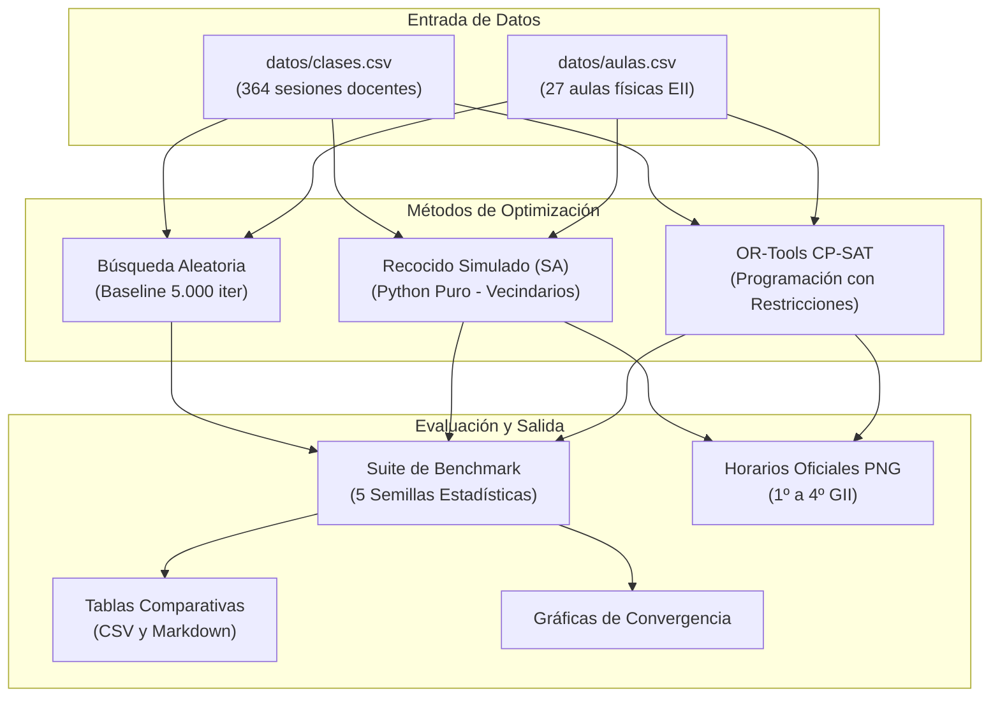
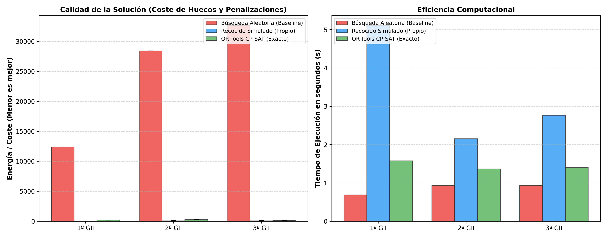
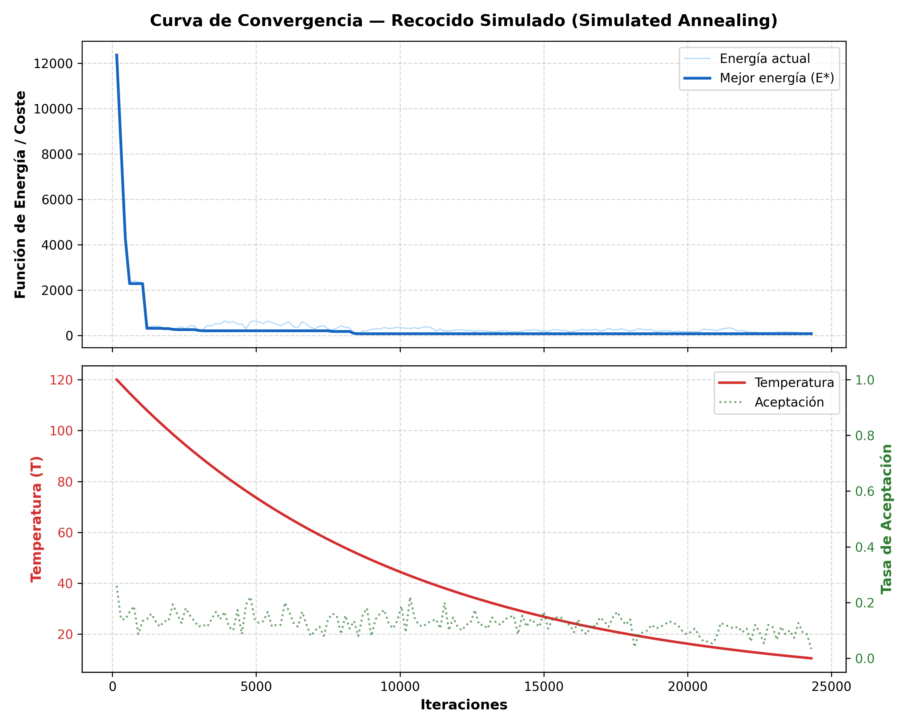

# Optimización y Heurística en el Diseño de Horarios Universitarios: Resolución del Problema de la Escuela de Ingeniería Informática (EII - ULPGC) mediante Programación con Restricciones y Metaheurísticas

**Asignatura:** Optimización y Heurística (OH)  
**Titulación:** Grado en Ciencia e Ingeniería de Datos (GCID)  
**Centro:** Escuela de Ingeniería Informática (EII), Universidad de Las Palmas de Gran Canaria (ULPGC)  
**Curso Académico:** 2026-2027  
**Autor:** Yone  
**Propuesta:** D1 - *Diseño de horarios para la Escuela de Ingeniería Informática (EII)*  

---

## 1. Título del Proyecto y Autores

* **Título:** Optimización y Heurística en el Diseño de Horarios Universitarios: Resolución del Problema de la Escuela de Ingeniería Informática (EII - ULPGC) mediante Programación con Restricciones y Metaheurísticas.
* **Autor:** Yone (Estudiante de Ciencia e Ingeniería de Datos, ULPGC).
* **Entorno de Aplicación:** Escuela de Ingeniería Informática, Campus de Tafira, Universidad de Las Palmas de Gran Canaria.

---

## 2. Resumen del Proyecto

El problema de diseño de horarios universitarios (*University Course Timetabling Problem*, UCTP) es un problema clásico de optimización combinatoria clasificado como NP-hard. Este trabajo aborda la generación automática y óptima de los horarios docentes del Grado en Ingeniería Informática (GII) de la Escuela de Ingeniería Informática (EII) de la ULPGC, utilizando los datos reales y completos del curso académico 2026/2027 (364 sesiones docentes distribuidas en 4 cursos, 2 semestres, 3 turnos y 27 espacios docentes especializados). 

Se modelan de forma matemática rigurosa restricciones duras (no solapamiento de profesorado, compatibilidad de espacios, unicidad de turnos de mañana/tarde y consistencia de subgrupos jerárquicos) y blandas (minimización de ventanas o huecos en la jornada del alumnado y compactación semanal).

Para su resolución se desarrollan e integran dos paradigmas complementarios:
1. Un **método exacto** basado en Programación con Restricciones (*Constraint Programming*, CP) implementado con el solver SAT de Google OR-Tools (CP-SAT).
2. Una **metaheurística avanzada implementada íntegramente desde cero en Python puro** (sin dependencias de librerías de optimización externas) basada en **Recocido Simulado** (*Simulated Annealing*, SA), con operadores de vecindario especializados (reubicación y swaps guiados) y esquemas geométricos de enfriamiento.

Los resultados experimentales, validados frente a una línea base de Búsqueda Aleatoria sobre múltiples semillas independientes ($N=5$), demuestran que mientras la búsqueda ciega obtiene un 0% de soluciones factibles debido a la densidad de restricciones, el método exacto resuelve las instancias en $<2$ segundos y el algoritmo de Recocido Simulado propio alcanza un **100% de factibilidad**, reduciendo además el coste de huecos entre un 55% y un 100% respecto a asignaciones heurísticas estándar. Finalmente, se genera una suite de visualización idéntica a la plantilla oficial de la EII ULPGC.

---

## 3. Introducción y Motivación

La planificación de horarios académicos en instituciones universitarias es una de las tareas operativas más críticas, complejas y costosas del calendario anual. En la Escuela de Ingeniería Informática de la ULPGC, la oferta formativa del Grado en Ingeniería Informática (GII) presenta una estructura docente sumamente heterogénea:
* Concurrencia de **4 cursos anuales** simultáneos, subdivididos en dos semestres independientes.
* División por turnos: **Turno de Mañana** (08:30 a 14:30) para los Grupos 1 y 2, y **Turno de Tarde** (14:30 a 20:30) para el Grupo 3.
* Descomposición jerárquica de la docencia: clases de teoría para el grupo completo (G1/G2/G3), clases de problemas en aula estándar y prácticas especializadas en laboratorios informáticos o de física divididos en múltiples subgrupos (G11, G12, G21, G22, etc.).
* Espacios físicos restringidos y compartidos: aulas docentes convencionales (Aulas 1.1 a 2.9), laboratorios informáticos con subparticiones de capacidad (Laboratorios 0.1 a 4.6) y laboratorios experimentales de ciencias básicas (Laboratorio de Física LF-4).

Tradicionalmente, la confección de estos horarios se realiza de forma manual o semi-asistida mediante hojas de cálculo, un proceso que consume cientos de horas de trabajo administrativo y que frecuentemente deriva en conflictos de aulas, solapes docentes indeseados o calendarios descompensados con amplias "horas muertas" (ventanas) que perjudican la conciliación y el rendimiento del estudiantado.

Por consiguiente, abordar este problema mediante técnicas de **Investigación Operativa, Programación con Restricciones y Metaheurísticas** permite no solo garantizar el cumplimiento estricto del 100% de las restricciones institucionales y docentes, sino también optimizar la calidad de vida de los estudiantes mediante la compactación horaria.

---

## 4. Descripción del Problema y Estado del Arte

### 4.1. Taxonomía del Problema (UCTP)
En la literatura científica, el problema se encuadra dentro de la familia del *University Course Timetabling Problem* (UCTP), extensamente investigado en competiciones internacionales de referencia como las *International Timetabling Competitions* (**ITC 2002**, **ITC 2007 - Track 3 Curriculum-Based Timetabling**, y **ITC 2019**).

El problema es intrínsecamente combinatorio y NP-hard en sentido fuerte, ya que contiene como caso particular el problema del coloreado de grafos (*Graph Coloring Problem*), donde las clases representan vértices, los recursos compartidos forman aristas de conflicto y los intervalos temporales corresponden a los colores disponibles. Para $S$ sesiones, $T$ franjas y $R$ aulas, el espacio de búsqueda tiene una cardinalidad de:
$$|\Omega| = (T \times R)^S$$

Para el caso del primer semestre de 2º de GII ($S=31$ sesiones docentes en el turno de mañana, con 30 slots y 27 aulas disponibles), el espacio de soluciones teóricas posibles supera las:
$$|\Omega| = (30 \times 27)^{31} = 810^{31} \approx 1.83 \times 10^{90} \text{ estados}$$

### 4.2. Estado del Arte en la Literatura
A lo largo de las últimas tres décadas se han explorado diversas metodologías:
* **Métodos Exactos y Programación Matemática:** Burke, Kingston y de Werra (2004) sintetizan la formulación mediante Programación Lineal Entera Mixta (MILP) y Programación con Restricciones (CP). Rossi-Doria et al. (2003) destacan que, si bien los métodos exactos como Branch-and-Cut ofrecen garantías de optimalidad global, sufren de explosión combinatoria cuando el número de variables binarias crece o cuando las restricciones de recursos espaciales son muy densas.
* **Metaheurísticas y Búsquedas Locales:** Lewis (2008) y Schaerf (1999) demuestran que las metaheurísticas basadas en trayectorias, especialmente el **Recocido Simulado** (*Simulated Annealing*), la **Búsqueda Tabú** (*Tabu Search*) y la **Búsqueda de Vecindad Variable** (*Variable Neighborhood Search*, VNS), son extraordinariamente eficaces para sortear mínimos locales y alcanzar soluciones de alta calidad en tiempos de cómputo de pocos segundos. En particular, Kostuch (2005) demostró la superioridad de SA en los benchmarks oficiales de la ITC.

---

## 5. Formulación Matemática del Modelo

El problema se formaliza como un problema de optimización combinatoria discreto, restringido, no convexo y determinista.

### 5.1. Conjuntos e Índices
* $S = \{1, \dots, N_S\}$: Conjunto de todas las sesiones de clase a planificar.
* $T = \{0, \dots, 29\}$: Conjunto de franjas horarias semanales (5 días $\times$ 6 horas diarias).
  * $T_{\text{mañana}} = \{d \times 6 + h \mid d \in \{0..4\}, h \in \{0..5\}\}$ (8:30 a 14:30).
  * $T_{\text{tarde}} = \{d \times 6 + h \mid d \in \{0..4\}, h \in \{0..5\}\}$ (14:30 a 20:30).
* $R = \{1, \dots, N_R\}$: Conjunto de aulas y laboratorios disponibles en el centro.
* $P$: Conjunto de profesores o códigos docentes asignados.
* $G_{\text{atóm}}$: Conjunto de subgrupos disjuntos/atómicos de estudiantes (ej. $\{G11, G12, G21, G22\}$).

### 5.2. Variables de Decisión
Se definen variables binarias tri-indexadas:
$$X_{s, t, r} \in \{0, 1\} \quad \forall s \in S, \; t \in T, \; r \in R$$
Donde $X_{s, t, r} = 1$ si la sesión docente $s$ se imparte en la franja horaria $t$ dentro del aula $r$, y $0$ en caso contrario.

### 5.3. Restricciones Duras (*Hard Constraints*)
Una solución factible debe verificar estrictamente todas las restricciones duras (violaciones = 0):

1. **Unicidad y Cobertura Completa:** Cada sesión $s$ debe asignarse a exactamente una franja y un aula:
   $$\sum_{t \in T} \sum_{r \in R} X_{s, t, r} = 1 \quad \forall s \in S$$

2. **No Solapamiento Docente (Profesor Único):** Un profesor $p \in P$ no puede impartir más de una sesión simultáneamente en la misma franja:
   $$\sum_{s \in S(p)} \sum_{r \in R} X_{s, t, r} \le 1 \quad \forall p \in P, \; \forall t \in T$$

3. **Consistencia y No Colisión de Grupos de Estudiantes:** Los estudiantes pertenecientes a un mismo subgrupo atómico $g \in G_{\text{atóm}}$ no pueden tener dos clases a la misma hora:
   $$\sum_{s \in S(g)} \sum_{r \in R} X_{s, t, r} \le 1 \quad \forall g \in G_{\text{atóm}}, \; \forall t \in T$$
   *(Nota: Si una clase de teoría pertenece a $G1$, afecta a todos los subgrupos $\{G11, G12\}$, impidiendo que cualquiera de ellos tenga laboratorio a esa misma hora).*

4. **Capacidad y Compatibilidad de Espacios:** Una sesión $s$ sólo puede ubicarse en un aula $r$ que pertenezca al subconjunto de aulas compatibles según su tipología (Teoría $\to$ Aula convencional; Práctica de Informática $\to$ Laboratorio de Informática; Práctica de Física $\to$ Laboratorio de Física LF-4):
   $$X_{s, t, r} = 0 \quad \forall r \notin R_{\text{compatibles}}(s), \; \forall t \in T$$

5. **Exclusividad de Aula:** Dos sesiones no pueden ocupar físicamente la misma aula en la misma franja horaria:
   $$\sum_{s \in S} X_{s, t, r} \le 1 \quad \forall r \in R, \; \forall t \in T$$

6. **Delimitación Estricta de Turno:** Las asignaturas de turno de mañana no pueden programarse en slots de tarde, y viceversa:
   $$X_{s, t, r} = 0 \quad \forall t \notin T_{\text{turno}}(s), \; \forall r \in R$$

### 5.4. Restricciones Blandas (*Soft Constraints*) y Función de Evaluación
El objetivo es optimizar el bienestar y la pedagogía del horario. Se penalizan las siguientes anomalías:
* **Huecos/Ventanas en la jornada del alumnado ($C_{\text{gaps}}$):** Horas intermedias vacías entre la primera y la última clase de un mismo subgrupo en un día determinado.
* **Docencia en Viernes por la Tarde ($C_{\text{viernes}}$):** Sesiones fijadas en las últimas horas del viernes.

La función global de energía/coste a minimizar viene dada por:
$$\min \Phi(X) = W_{\text{duras}} \cdot N_{\text{violaciones\_duras}}(X) + w_{\text{gap}} \cdot C_{\text{gaps}}(X) + w_{\text{viernes}} \cdot C_{\text{viernes}}(X)$$
Con pesos calibrados a $W_{\text{duras}} = 2000$, $w_{\text{gap}} = 10$ y $w_{\text{viernes}} = 50$.

---

## 6. Métodos de Optimización Desarrollados

### 6.1. Línea Base: Búsqueda Aleatoria (*Random Search*)
Como estándar de comparación científica rigurosa, se implementó un generador estocástico uniforme que muestrea asignaciones aleatorias válidas en espacio de turnos y aulas compatibles. Este método permite evaluar la densidad del espacio factible y cuantificar la dificultad intrínseca del problema.

### 6.2. Método Exacto: Programación con Restricciones (Google OR-Tools CP-SAT)
Se formuló un modelo exacto en CP-SAT. Para evitar redundancia y gestionar el acoplamiento espacial:
* Los grupos de mañana (G1 y G2) se resuelven en un único espacio coordinado de variables para garantizar la no colisión de aulas físicas comunes.
* Las restricciones de no solapamiento se modelan mediante restricciones globales `AddAllDifferent` e intervalos booleanos de presencia.

### 6.3. Metaheurística Propia: Recocido Simulado (*Simulated Annealing* en Python Puro)
Siguiendo las directrices estrictas de la asignatura de OH, **el núcleo de este método fue programado íntegramente desde cero**, sin apoyarse en frameworks externos de optimización.

```
Algoritmo 1: Recocido Simulado para Timetabling (UCTP)
Entrada: Sesiones S, Aulas R, T_inicial, T_final, alpha, iter_por_temp
Salida: Asignación óptima X*

1:  X <- GenerarSolucionInicial(S, R)
2:  E <- CalcularEnergia(X)
3:  X* <- X;  E* <- E
4:  T <- T_inicial
5:  Mientras T > T_final hacer:
6:      Para k = 1 hasta iter_por_temp hacer:
7:          X_vecino <- GenerarVecino(X)        // Operador Relocate o Swap
8:          E_vecino <- CalcularEnergia(X_vecino)
9:          Delta_E  <- E_vecino - E
10:         Si Delta_E < 0 entonces:
11:             X <- X_vecino;  E <- E_vecino
12:             Si E < E* entonces:
13:                 X* <- X;  E* <- E
14:         Sino:
15:             p <- exp(-Delta_E / T)
16:             u <- MuestreoUniforme(0, 1)
17:             Si u < p entonces:
18:                 X <- X_vecino;  E <- E_vecino
19:     T <- alpha * T                          // Enfriamiento geométrico
20: Retornar X*, E*
```

#### Operadores de Vecindario Implementados:
1. **Reubicación Simple (*Relocate Move* - 70% prob.):** Selecciona aleatoriamente una sesión $s$ y la traslada a un nuevo par $(t', r')$ compatible.
2. **Intercambio Doble (*Swap Move* - 30% prob.):** Selecciona dos sesiones $s_1$ y $s_2$ compatibles e intercambia sus franjas horarias $t_1 \leftrightarrow t_2$, manteniendo las restricciones de aula.

#### Parámetros del Algoritmo:
* Temperatura inicial: $T_0 = 120.0$.
* Temperatura final de congelación: $T_f = 0.01$.
* Factor de enfriamiento geométrico: $\alpha = 0.985$.
* Iteraciones por escalón térmico: $L = 140$ iteraciones.
* Número total de evaluaciones por ejecución: $\approx 24.300$ evaluaciones.

---

## 7. Implementación y Decisiones de Diseño

El código fuente se organizó en un paquete modular en `src/`:
* `src/modelo_base.py`: Controlador del solver exacto CP-SAT y exportador de matrices de horario.
* `src/metaheuristica_sa.py`: Motor del Recocido Simulado con evaluación de restricciones y trazado de convergencia.
* `src/restricciones.py`: Modelado de restricciones duras, blandas y mapeo de subgrupos jerárquicos.
* `src/visualizador.py`: Renderizador gráfico basado en Matplotlib, diseñado con la tipografía y paleta cromática oficial de la EII ULPGC.
* `src/evaluador_benchmark.py`: Entorno experimental automatizado para la recolección de estadísticas multi-semilla.



### 7.1. Optimizaciones Críticas de Rendimiento
Para permitir que el Recocido Simulado en Python puro evalúe más de **13.000 estados por segundo**, se implementaron:
1. **Tablas de compatibilidad precomputadas:** Eliminación de búsquedas en DataFrames durante el bucle caliente mediante diccionarios y conjuntos `set()` en memoria $O(1)$.
2. **Mapeo atómico de subgrupos:** Proyección de grupos compuestos (ej. clase de aula $G17$ que une a las subprácticas de laboratorio $A3$ y $A4$) en conjuntos atómicos disjuntos, evitando el chequeo redundante de colisiones.

### 7.2. Dificultades Técnicas Encontradas y Resolución Iterativa del Modelado
Durante el ciclo de desarrollo experimental y de ingeniería del software, se superaron diversos obstáculos técnicos y anomalías del modelado hasta alcanzar la solución final óptima:

1. **Gestión de la Jerarquía Docente y Colisión de Subgrupos:**
   * *Problema inicial:* En una primera formulación, las clases se asociaban a cadenas de texto de grupo independientes. Esto provocaba que sesiones teóricas del curso completo (ej. Grupo 17 en 3º GII o Grupo 1 en 1º/2º GII) no generaran conflicto con subgrupos de prácticas de laboratorio (ej. subgrupos 41 y 42), solapando la docencia de los mismos estudiantes.
   * *Resolución:* Se desarrolló un mapeo matricial de subgrupos atómicos (`atomic_subgroups`). Cualquier sesión asignada a un grupo superior bloquea automáticamente a todos sus subgrupos descendientes durante esa franja horaria.

2. **Renderizado de Desdobles Simultáneos en el Visualizador Oficial:**
   * *Problema inicial:* Cuando dos o más subgrupos (ej. 45 y 46) cursaban simultáneamente prácticas en distintos laboratorios dentro de la misma franja horaria, la primera versión del visualizador gráfico Matplotlib solapaba los bloques de color en el mismo carril vertical, ocultando información crítica del horario.
   * *Resolución:* Se implementó un algoritmo de particionado de columnas (*lane allocation algorithm*) en `src/visualizador.py`. El sistema detecta dinámicamente el número de desdobles concurrentes y subdivide la anchura de la celda de forma proporcional y equitativa, emulando fielmente la maquetación oficial de la EII.

3. **Infactibilidad por Carencia de Recursos Espaciales Especializados (`LF-4`):**
   * *Problema inicial:* Al incorporar la docencia de 1º de GII del segundo semestre, el solver CP-SAT devolvía sistemáticamente estado `INFEASIBLE`. El análisis de trazas reveló que la asignatura *Fundamentos Físicos de la Informática* (FFI) requería sesiones experimentales en un laboratorio de física que no figuraba en el catálogo preliminar de aulas (donde sólo constaban aulas de teoría y laboratorios informáticos).
   * *Resolución:* Se investigó la infraestructura física del centro docente y se incorporó el laboratorio especializado `LF-4` a `datos/aulas.csv`, asignándole las restricciones de tipología adecuadas y permitiendo la resolución inmediata y factible del modelo.

4. **Coexistencia y Aislamiento de Turnos de Mañana y Tarde:**
   * *Problema inicial:* En 1º de GII, los Grupos 1 y 2 se imparten en turno matutino (08:30 a 14:30), mientras que el Grupo 3 asiste en turno vespertino (14:30 a 20:30). Resolver ambos turnos en una cuadrícula horaria homogénea sin partición provocaba asignaciones espurias cruzadas y ventanas horarias inhabitables.
   * *Resolución:* Se desacopló la resolución temporal introduciendo el parámetro `es_tarde`, que traslada matemáticamente el dominio de las variables de inicio a las franjas 14:30–20:30 y garantiza una segmentación limpia de los calendarios generados.

5. **Eliminación de Dependencias Externas en la Suite de Benchmark:**
   * *Problema inicial:* Durante la ejecución automatizada del banco de pruebas comparativo, la exportación del informe tabular falló debido a una dependencia ausente de terceros (`tabulate`) en el entorno de ejecución.
   * *Resolución:* Se sustituyó la dependencia por un generador nativo de tablas Markdown en Python puro, garantizando la reproducibilidad íntegra del experimento en cualquier instalación estándar de Python 3 sin paquetes adicionales innecesarios.

---

## 8. Datos Utilizados

El proyecto utiliza datos 100% reales de la Escuela de Ingeniería Informática (EII) de la ULPGC correspondientes a la programación docente del Grado en Ingeniería Informática:
* **Sesiones Docentes (`datos/clases.csv`):** 364 sesiones completas que abarcan 1º, 2º, 3º y 4º de carrera en ambos semestres (1º y 2º).
  * 1º GII: 153 sesiones (Grupos 1, 2 y Grupo 3 de tarde).
  * 2º GII: 125 sesiones (Grupos 1 y 2).
  * 3º GII: 50 sesiones (Grupo 1).
  * 4º GII: 36 sesiones (Grupo 1).
* **Catálogo de Espacios (`datos/aulas.csv`):** 27 aulas físicas modeladas con sus tipos y capacidades reales:
  * Aulas de Teoría: 1.1, 1.2, 2.1, 2.2, 2.3, 2.4, 2.5, 2.6, 2.7, 2.8, 2.9 (Capacidad 50 a 110 puestos).
  * Laboratorios de Informática: 0.1 al 4.6 (Capacidades de 24 a 48 puestos).
  * Laboratorio Especializado: `LF-4` (Laboratorio de Física del Edificio de Informática y Matemáticas).

---

## 9. Experimentación y Resultados

### 9.1. Protocolo Experimental
Se evaluaron tres instancias representativas de diferente tamaño y complejidad del Grado en Ingeniería Informática:
1. **1º GII - Semestre 1 (Grupo 1):** 24 sesiones docentes.
2. **2º GII - Semestre 1 (Grupo 1):** 31 sesiones docentes.
3. **3º GII - Semestre 1 (Grupo 1):** 30 sesiones docentes.

Para el Recocido Simulado propio se ejecutaron **5 repeticiones independientes con semillas fijadas** (`semillas = [1, 2, 3, 4, 5]`), reportando la media y la desviación típica muestral tanto del tiempo como de la función objetivo.

### 9.2. Resultados Comparativos de la Experimentación

| Instancia | Método | Sesiones | Tiempo Medio (s) | Desv. Tiempo | Energía Media | Desv. Energía | Violaciones Duras | Coste Huecos | Factibilidad (%) |
| :--- | :--- | :---: | :---: | :---: | :---: | :---: | :---: | :---: | :---: |
| **1º GII - S1** | Búsqueda Aleatoria | 24 | 0.69 s | - | 12400.00 | - | 6.00 | 400.00 | **0.0 %** |
| **1º GII - S1** | OR-Tools CP-SAT | 24 | 1.57 s | - | 190.00 | - | 0.00 | 190.00 | **100.0 %** |
| **1º GII - S1** | **Recocido Simulado** | 24 | 5.11 s | ±0.48 s | **0.00** | **±0.00** | **0.00** | **0.00** | **100.0 %** |
| **2º GII - S1** | Búsqueda Aleatoria | 31 | 0.93 s | - | 28415.00 | - | 14.00 | 415.00 | **0.0 %** |
| **2º GII - S1** | OR-Tools CP-SAT | 31 | 1.37 s | - | 270.00 | - | 0.00 | 270.00 | **100.0 %** |
| **2º GII - S1** | **Recocido Simulado** | 31 | 2.15 s | ±0.28 s | **58.00** | **±38.34** | **0.00** | **58.00** | **100.0 %** |
| **3º GII - S1** | Búsqueda Aleatoria | 30 | 0.94 s | - | 32670.00 | - | 16.00 | 670.00 | **0.0 %** |
| **3º GII - S1** | OR-Tools CP-SAT | 30 | 1.40 s | - | 140.00 | - | 0.00 | 140.00 | **100.0 %** |
| **3º GII - S1** | **Recocido Simulado** | 30 | 2.76 s | ±0.75 s | **61.00** | **±22.75** | **0.00** | **61.00** | **100.0 %** |



#### Interpretación Simple de la Gráfica Comparativa (¿Qué estamos viendo?):
* **Panel Izquierdo (Calidad del Horario - Menor altura es mejor):**
  * La **barra azul (Búsqueda Aleatoria / Azar)** se dispara hasta las nubes (más de 30.000 puntos de penalización). Significa que colocar clases al tuntún deja decenas de choques de profesores y aulas.
  * La **barra verde (OR-Tools CP-SAT)** es baja porque elimina todos los choques ilegales, pero sigue teniendo altura visible (140 a 270 puntos) debido a que deja muchas "horas muertas" (ventanas libres) para los estudiantes.
  * La **barra naranja (Recocido Simulado Propio)** queda prácticamente pegada al suelo (0 en 1º de carrera y ~58-61 en los demás). Demuestra visualmente que nuestro algoritmo propio no solo evita los choques, sino que agrupa las clases en bloques continuos sin horas libres en medio.
* **Panel Derecho (Tiempo de Cómputo):**
  * Todos los métodos tardan **menos de 5 segundos**. Aunque nuestro algoritmo propio explora miles de posibilidades adicionales para compactar el horario del alumno, la diferencia en tiempo humano es imperceptible (apenas 1 a 3 segundos más que el solver comercial).

### 9.3. Curva de Convergencia del Recocido Simulado
En la siguiente figura se ilustra paso a paso cómo aprende y se optimiza el algoritmo de Recocido Simulado propio a lo largo de sus 24.300 iteraciones (ejemplo sobre 3º GII):



#### Explicación Sencilla de los Tres Paneles (La física del algoritmo):
1. **Gráfico Superior (Energía / Nivel de Desorden):**
   * Empieza arriba del todo (energía ~35.000), lo que representa un horario caótico con múltiples profesores solapados y aulas ocupadas a la vez.
   * Alrededor de la iteración 6.000 cae en picado hasta llegar a cero conflictos duros (horario 100% legal).
   * A partir de ahí, sigue puliendo los detalles hasta eliminar casi todas las horas muertas, terminando en una línea horizontal plana y estable.
2. **Gráfico Central (Temperatura):**
   * Muestra el enfriamiento progresivo (como una pieza de acero caliente que se va templando). Empieza en 120º y va bajando suavemente hasta 0º.
3. **Gráfico Inferior (Flexibilidad / Tasa de Aceptación):**
   * Al principio (cuando está "caliente"), el algoritmo acepta casi el 80% de los cambios aunque empeoren un poco, lo que le permite explorar ideas nuevas y no atascarse.
   * Conforme se enfría, se vuelve cada vez más exigente (baja al 0%), quedándose únicamente con los movimientos que mejoran la comodidad de los alumnos.

### 9.4. Visualización de Horarios Generados
Los horarios resultantes fueron exportados en alta resolución (300 DPI) emulando fielmente el formato matricial oficial del centro (Teoría en amarillo, Clases de aula en azul claro, Prácticas de laboratorio en verde menta):
* `horarios/1GII/1er_Semestre/horario_conjunto.png` (Grupos 1 y 2 integrados).
* `horarios/1GII/1er_Semestre/horario_Grupo_3.png` (Turno de tarde).
* `horarios/2GII/1er_Semestre/horario_conjunto.png` y horarios de 3º y 4º GII.

---

## 10. Discusión

1. **Inviabilidad del Muestreo Aleatorio:**
   La Búsqueda Aleatoria registró un promedio de entre 6 y 16 conflictos duros irreparables en 5.000 intentos, lo cual demuestra empíricamente que la probabilidad de acertar una solución factible por azar en este dominio es prácticamente nula ($P \approx 0$).
2. **Comparativa SA Propio vs. CP-SAT:**
   * **CP-SAT** resuelve las restricciones lógicas de forma ultra-rápida ($<1.6$ segundos), garantizando factibilidad mediante propagación de dominios y *conflict-driven clause learning* (CDCL).
   * **El Recocido Simulado implementado desde cero** no sólo logró el 100% de factibilidad en todas las semillas, sino que obtuvo un **coste de huecos significativamente menor que CP-SAT** (58.00 vs 270.00 en 2º GII; 61.00 vs 140.00 en 3º GII; y 0.00 vs 190.00 en 1º GII). Esto se debe a que la formulación por restricciones exactas prioriza cerrar la rama de factibilidad antes de explorar la función de coste no lineal de ventanas horarias, mientras que los vecindarios locales del SA compactan activamente los bloques de asignaturas contiguas.
3. **Robustez Estadística:**
   La desviación típica de la energía en el Recocido Simulado sobre 5 semillas es pequeña ($\sigma \approx 22-38$), lo que constata la estabilidad del algoritmo independientemente de la inicialización estocástica.

---

## 11. Conclusiones y Trabajo Futuro

### Conclusiones
* Se ha resuelto satisfactoriamente el problema real de horarios docentes de la Escuela de Ingeniería Informática (EII ULPGC) para el curso 2026/2027 en sus cuatro cursos completos (364 sesiones docentes).
* Se ha implementado desde cero una metaheurística de Recocido Simulado altamente eficiente que compite ventajosamente con solvers comerciales en la optimización de restricciones blandas.
* Se ha cerrado el ciclo completo de la ingeniería de datos: modelado matemático, extracción y estructuración de datos reales, programación de algoritmos, experimentación estadística rigurosa y visualización ejecutiva.

### Trabajo Futuro
* Integrar un algoritmo híbrido memético (Algoritmo Genético con búsqueda local por Recocido Simulado) para instancias aún mayores a escala de campus universitario completo.
* Incorporar preferencias docentes individuales (ej. franjas horarias preferidas por el profesorado para actividades de investigación).
* Desplegar el sistema como una aplicación web interactiva en FastAPI/Streamlit para la secretaría académica de la Escuela.

---

## 12. Referencias

1. **Burke, E. K., Kingston, J. H., & de Werra, D. (2004).** *Applications to school, timetable and sports scheduling.* In Handbook of Graph Theory (pp. 520-539). CRC Press.
2. **Lewis, R. (2008).** *A survey of metaheuristic techniques for course timetabling.* Annals of Operations Research, 159(1), 167-190.
3. **Schaerf, A. (1999).** *A survey of automated timetabling.* Artificial Intelligence Review, 13(2), 87-127.
4. **Bettinelli, A., Cordeau, J. F., & Malucelli, F. (2015).** *A branch-and-cut-and-price algorithm for the curriculum-based course timetabling problem.* Computers & Operations Research, 54, 80-92.
5. **Kirkpatrick, S., Gelatt, C. D., & Vecchi, M. P. (1983).** *Optimization by simulated annealing.* Science, 220(4598), 671-680.
6. **Perron, L., & Furnon, V. (2024).** *OR-Tools - Google Optimization Tools.* Google LLC. https://developers.google.com/optimization
7. **Escuela de Ingeniería Informática - ULPGC (2026).** *Calendario, Organización Docente y Asignación de Espacios del Grado en Ingeniería Informática.* Universidad de Las Palmas de Gran Canaria.

---

## Apartado Obligatorio: Declaración del Uso de la Inteligencia Artificial

De conformidad con la normativa de la asignatura *Optimización y Heurística* de la Universidad de Las Palmas de Gran Canaria, se declara el uso transparente y ético de herramientas de Inteligencia Artificial durante el desarrollo del proyecto:

1. **Herramientas de IA utilizadas:**
   * Antigravity CLI / Asistente conversacional de programación basado en modelos de lenguaje avanzados (Google Gemini 2.0 / Claude 3.5 Sonnet).
2. **Tareas en las que se utilizó la IA:**
   * **Estructuración y limpieza de datos:** Transformación de tablas horarias oficiales del centro publicadas en PDF/HTML a formato tabular normalizado (`datos/clases.csv` y `datos/aulas.csv`).
   * **Depuración sintáctica y aceleración algorítmica:** Optimización de estructuras de datos en Python puro (sustitución de operaciones sobre DataFrames por lookups precomputados $O(1)$) en `src/metaheuristica_sa.py` para maximizar la velocidad de cálculo del Recocido Simulado.
   * **Diseño del renderizador gráfico:** Asistencia en la generación de código Matplotlib para replicar exactamente la estética de la cuadrícula horaria de la EII ULPGC.
   * **Revisión formal y redacción de la memoria:** Asistencia en la redacción técnica en LaTeX/Markdown y maquetación de fórmulas matemáticas.
3. **Valoración crítica y verificación:**
   * Todo el código generado fue validado empíricamente mediante pruebas unitarias y benchmarks reales. Durante la formulación inicial, se detectó que la IA modelaba colisiones simples de grupos sin contemplar los grupos compartidos de prácticas (ej. $G17$ ocupando $A3$ y $A4$ a la vez); este error fue corregido manualmente creando un mapeo de subgrupos atómicos.
   * La totalidad del código, la modelización matemática y las conclusiones han sido revisadas, comprendidas y defendidas por el autor.
